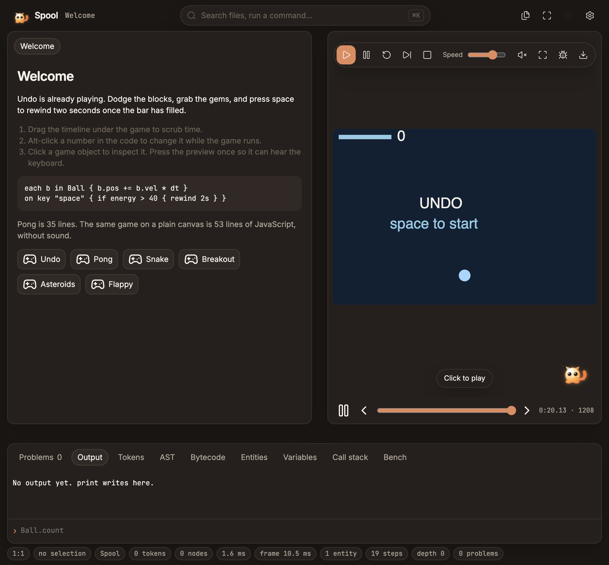
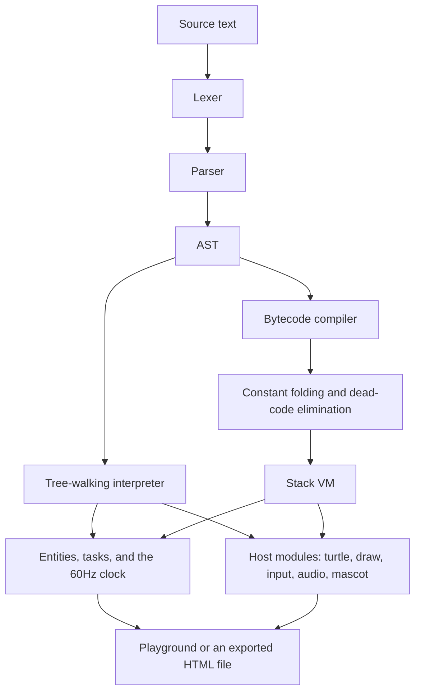
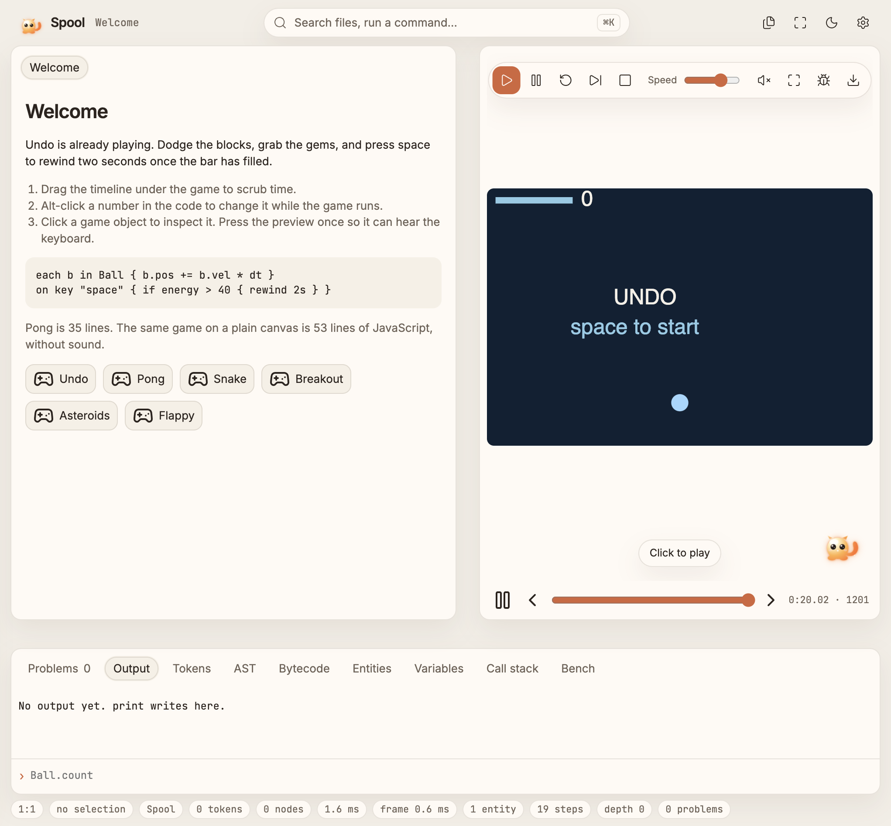
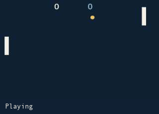

# Spool

Game programming language with rewind and a live browser studio.



```bash
npm install
npm test
npm run dev
```

Spool is a small programming language for games, running in the browser. The name is a film spool: a length of time you can wind back. A program can draw, listen, keep entities, wait on a clock, and rewind. The turtle is one module.

- `+=`, `-=`, and `*=` update a name, a field, or an index.
- `vec(x, y)` is a position or a velocity. An entity field named `pos` is the center, set by `at`, and collisions read it.
- `each ball in Ball { }` visits every living entity. `where` is optional.
- `when ball in Ball touches pad in Paddle { }` runs on every overlapping frame.
- `clamp`, `lerp`, and `bounce` work on numbers, quantities, and, for `bounce` and `lerp`, vecs.
- `task`, `wait`, `every`, and `after` run on the 60Hz clock.
- `rewind 2s` restores entities, variables, the random stream, and running tasks. An energy bar is ordinary game code: check it, then rewind, and the restored bar is the lower past value.
- Pong is 35 lines, Snake 45, Breakout 41, and the rewind demo `undo.spool` is 65.

The implementation is a hand-written **lexer**, **recursive descent parser**, **tree-walking interpreter**, and **stack VM** in TypeScript. No parsing libraries. Tests run the same programs on both backends.

## Language spec

Keep it small on purpose.

### Values and variables

- Numbers, strings, and booleans: `true`, `false`
- Arrays: `[1, 2, 3]`. Read with `a[i]`. Write with `a[i] = v`. Indexes are whole numbers starting at 0. A negative index is out of range.
- Strings: read one character with `s[i]` (a string of length 1). Assigning into a string is an error.
- `len(array)` and `len(string)` return the length. `push(array, value)` adds an item and returns the same array. `pop(array)` removes and returns the last item.
- `slice(value, start, end)` copies a half-open range from a string or an array. Indexes are whole numbers; `start` and `end` must lie in `0..len(value)`.
- `ord(s)` is the code unit of a one-character string. `char(n)` builds that character from a whole number `0..65535`.
- Define a name: `let size = 50`. A second `let` of the same name in one scope is an error.
- Change a name that already exists, including one outside the current block: `n = n + 1`, `n += 1`, `n -= 1`, `n *= 2`. The same three updates work on `items[i]` and `ball.vel`.
- Maps: `{ "ada": 10, bea: 12 }`. A bare key is the name, not a lookup. Read and write with `m["ada"]`. Missing keys are an error. `for k in m` visits keys in insertion order.
- Records: `record Paddle { x, y }` then `Paddle { x: 1px, y: 2px }`. Fields are `p.x` and `p.x = 1px`. Construction must supply every field.
- `vec(x, y)` is a pair. `+` and `-` are component-wise. `*` and `/` take a scalar. Both components share a unit. `v.x` and `v.y` read or write a component. `==` compares vecs by value.
- `==` and `!=` compare numbers, strings, booleans, quantities, and vecs by value. Arrays, maps, records, and functions are equal only when they are the same object.
- Comments start with `#`

### Expressions

- Arithmetic with correct precedence: `+` `-` `*` `/` `%`, parentheses, unary minus
- `+` adds two numbers, or joins two strings (`"Fizz" + "Buzz"`). A number plus a string is an error.
- A number can wear a unit: `1.5s`, `120px`, `80px/s`. `+` and `-` need the same unit. `*` and `/` combine units, and `px/s * s` is `px`. A plain number is its own kind, so `1px + 1` is an error. `10px / 2px` is the plain number `5`.
- Comparisons: `==` `!=` `<` `>` `<=` `>=`. Ordered comparisons need two numbers, or two quantities of the same unit.
- Booleans: `true` `false` `and` `or` `not`. `and` and `or` stop early. Conditions need a real boolean.
- Strings interpolate with braces: `"score: {score}"`. A literal brace is `\{`.
- The pipe `|>` calls a function with the value on the left. `1 + 2 |> inc` is `inc(3)`. `n |> add(10)` is `add(n, 10)`. It binds more loosely than `or`.
- `match` tries patterns in order: literals, quantities, `vec(x, y)`, `Point { x: x, y: _ }`, a name that binds, or `_`. The first match wins. If none match, the program stops.
- A function expression: `fn(x) { return x + 1 }`. It can be stored, passed, returned, and called. It closes over the names it can see.

### Control flow

- `if` / `else`. The `else` body is a block.
- `while`
- `repeat N { ... }`. `N` is a whole number, zero or greater.
- `for i in start..end { ... }`. `start` and `end` are whole numbers, read once. The range is exclusive, so `0..3` binds `i` to 0, then 1, then 2. Each pass gets its own `i`, so a function created in the body keeps that pass's value. Assigning to `i` does not move the counter.
- `for x in collection { ... }`. Arrays yield items, strings yield characters, and maps yield keys. The list is fixed when the loop starts. Each pass gets its own binding.

### Functions

- A named function is a statement: `fn square(s) { ... }`. It can call itself.
- An unnamed function is an expression: `fn(x) { return x }`. Its name in a stack trace is `(anonymous)`.
- Calls: `square(100)`, `fns[0]()`, `(fn(x) { return x })(1)`.
- `return` is only allowed inside a function.

### Math and collections

| Call | Meaning |
|------|---------|
| `sin(n)` `cos(n)` | Sine and cosine. `n` is radians, not degrees |
| `sqrt(n)` | Square root of a number that is zero or greater |
| `abs(n)` | Absolute value |
| `random()` | A number from 0 up to, but not including, 1 |
| `min(a, b, ...)` `max(a, b, ...)` | Smallest or largest of two or more numbers |
| `hsl(h, s, l)` | A color string. `h` is the hue in degrees, `s` and `l` are percentages |
| `clamp(value, low, high)` | Lowest and highest share a unit with `value` |
| `lerp(a, b, t)` | `t` is a plain number. `a` and `b` are numbers, quantities, or vecs |
| `bounce(v)` | Negate a number, a quantity, or a vec |
| `len(value)` | Length of an array or a string |
| `push(array, value)` | Append `value` and return the array |
| `pop(array)` | Remove and return the last item |
| `slice(value, start, end)` | Half-open copy of a string or array |
| `ord(s)` | Code unit of a one-character string |
| `char(n)` | One-character string from a code unit |

`random` is deterministic when a run is given a seed. The playground seed is the number in the toolbar, and it is part of the share link. The same program and the same seed do the same thing on the tree-walker and on the VM. With no seed, `random` uses `Math.random`.

### Modules

```
use turtle
turtle.forward(40)
turtle.turn(90)
```

`use name` binds a module the host registered under that name. A call is `turtle.forward(40)`. The interpreter never hears about a canvas, the DOM, or Web Audio. It only sees the functions the host handed it. `use` of a name the host did not register is an error. Assigning to a module is an error.

The playground registers `turtle`, `draw`, `input`, and `audio`. It also keeps the turtle commands as bare names, so an older program can still say `forward 40` without `use turtle`. The page registers `mascot` as well. `mascot.react(name)` asks Pipkin for a reaction. The gallery games do not use it, and neither engine draws it.

| Module | Calls |
|--------|--------|
| `turtle` | `forward` `back` `turn` `penup` `pendown` `color` `width` `goto` `print` |
| `draw` | `background` `camera` `rect` `circle` `line` `text` `sprite` |
| `input` | `key` `mouse` `click` |
| `audio` | `beep` `tone` `play` |
| `mascot` | `react`. The page only. Not part of an exported game |

`draw` records shapes. The page paints them after the update. Coordinates are numbers or `px`. The origin is the top left, and y grows downward. `sprite` draws an emoji, or pixel art when the string contains a newline (`.` and space are empty). `input.key` is true while the key is held. `input.mouse` is a px vec. `input.click` is true for the frame the button goes down. `audio` records a cue. The page plays it. `beep(freq, duration)` is a square wave. `tone` takes `sine`, `square`, `triangle`, or `saw`. `play` is `hit`, `score`, or `boom`. Frequency is a plain number above 0. Duration is a time in seconds.

### Events

```
let n = 0
on start { n = 1 }
on tick(dt) { n = n + 1 }
on key "space" { n = n + 10 }
on key_up "space" { n = n + 100 }
```

`on start` runs once, when the clock begins. `on tick(dt)` runs 60 times a second. `dt` is `1/60 s`. `on key` and `on key_up` run for the matching key in that frame. The same program, the same seed, and the same list of keys produce the same run. The page plays this on a fixed step and draws between steps.

### Turtle module

| Command   | Meaning                          |
|-----------|----------------------------------|
| `forward` | Move forward by a distance       |
| `back`    | Move backward                    |
| `turn`    | Rotate clockwise by degrees. Heading 0 points up |
| `penup`   | Stop drawing                     |
| `pendown` | Start drawing                    |
| `color`   | Set pen color                    |
| `width`   | Set pen width                    |
| `goto`    | Jump to a position               |
| `print`   | Print a value (console / output) |

A bare turtle command can be written without parentheses when it is a statement: `forward 40`, `goto 10 20`. A parenthesis uses the normal call. A name you defined yourself, and a module field, always needs parentheses.

### Example

```
record Paddle { x, y }

fn nudge(p, dt) {
  return match p {
    Paddle { x: x, y: y } => Paddle { x: x + 40px/s * dt, y: y }
  }
}

let score = 0
let p = Paddle { x: 10px, y: 20px }
p = nudge(p, 1.5s)
"score: {score} at {p.x}"
```

`nudge` returns a new paddle 60px to the right. The string is `score: 0 at 70px`.

Turtle drawings still use the older commands:

```
fn square(s) {
  repeat 4 { forward s  turn 90 }
}
repeat 36 {
  square(100)
  turn 10
}
```

### Grammar

A program is a list of statements. Comments start with `#` and run to the end of the line. Strings use double quotes, with `\"` `\\` `\n` `\t` `\{` and `\}`. A number may wear `px` or `s`, as in `120px` or `80px/s`. There is no scientific notation and no trailing dot.

```
program     = { statement } ;
statement   = let | assign | if | while | repeat | for
            | record | use | on | entity | despawn
            | each | when | task | wait | every | after
            | fn | return | command | expression ;
let         = "let" name "=" expression ;
assign      = target "=" expression ;
if          = "if" expression block [ "else" block ] ;
while       = "while" expression block ;
repeat      = "repeat" expression block ;
for         = "for" name "in" expression [ ".." expression ] block ;
record      = "record" name "{" [ name { "," name } ] "}" ;
use         = "use" name ;
on          = "on" "start" block
            | "on" "tick" "(" name ")" block
            | "on" ( "key" | "key_up" ) string block ;
entity      = "entity" name "{" [ name { "," name } ] "}" ;
despawn     = "despawn" expression ;
each        = "each" name "in" expression "where" expression block ;
when        = "when" name "in" expression "touches" name "in" expression block ;
task        = "task" name block ;
wait        = "wait" expression | "wait" "until" expression ;
every       = "every" expression block ;
after       = "after" expression block ;
fn          = "fn" name "(" [ name { "," name } ] ")" block ;
return      = "return" [ expression ] ;
block       = "{" { statement } "}" ;
fields      = "{" [ name ":" expression { "," name ":" expression } ] "}" ;

expression  = pipe ;
pipe        = or { "|>" or } ;
or          = and { "or" and } ;
and         = not { "and" not } ;
not         = "not" not | comparison ;
comparison  = sum { ( "==" | "!=" | "<" | ">" | "<=" | ">=" ) sum } ;
sum         = product { ( "+" | "-" ) product } ;
product     = unary { ( "*" | "/" | "%" ) unary } ;
unary       = "-" unary | postfix ;
postfix     = primary { "(" [ expression { "," expression } ] ")"
                      | "[" expression "]"
                      | "." name } ;
primary     = number | string | name | "true" | "false"
            | "[" [ expression { "," expression } ] "]"
            | "{" [ field { "," field } ] "}"
            | "fn" "(" [ name { "," name } ] ")" block
            | "spawn" expression "at" "(" expression "," expression ")" fields
            | "match" expression "{" { pattern "=>" expression } "}"
            | "(" expression ")" ;
field       = ( name | string ) ":" expression ;
pattern     = literal | name | "_" | "vec" "(" pattern "," pattern ")"
            | name "{" [ name ":" pattern { "," name ":" pattern } ] "}" ;
```

`|>` binds most loosely, then `or`, `and`, `not`, comparisons, `+` `-`, `*` `/` `%`, then unary minus. `not 1 == 2` is `not (1 == 2)`. `1 + 2 |> inc` is `inc(3)`. A `{` after a name is a record or a map when a field follows, and an empty `Name { }` is a record when a block is not required. After `if`, `while`, `for`, and `repeat`, `{ }` is the body.

`forward`, `back`, `turn`, `penup`, `pendown`, `color`, `width`, `goto`, and `print` may omit parentheses when they are a statement: `forward 40`, `goto 10 20`. A call with parentheses is the same thing. Any other function, and any module field, needs parentheses.

## Architecture



The playground runs the VM. The tree-walker is still the reference implementation, and the tests run every behavior on both. Neither engine touches the canvas. `rewind` restores a VM image, or replays the same frames on the tree-walker, including entities, variables, the random stream, and waiting tasks.

| File | Role |
|------|------|
| `src/lexer.ts` | Text → tokens, with line and column |
| `src/ast.ts` | Node type definitions |
| `src/parser.ts` | Tokens → AST (recursive descent + precedence climbing) |
| `src/interpreter.ts` | Evaluate the AST. `debug` pauses between statements. No canvas knowledge |
| `src/bytecode.ts` | Instruction set, chunks, and the disassembler |
| `src/compile.ts` | AST → bytecode. Names are resolved when the instruction runs, so a closure sees the live scope |
| `src/optimize.ts` | Constant folding, then dead-code elimination. Each pass can be turned off |
| `src/vm.ts` | Stack machine. Same errors, same step counts, same turtle drawing as the tree-walker |
| `src/errors.ts` | Error codes, source line, caret, and "did you mean" |
| `src/math.ts` | Pure math and color built-ins |
| `src/collections.ts` | `len` and `push` |
| `src/rng.ts` | Seeded `random`, mulberry32 |
| `src/benchmark.ts` | The three programs the bench panel times |
| `src/turtle.ts` | Turtle state and drawing commands |
| `src/audio.ts` | `audio` cues. The page plays them; rewind stays silent |
| `src/world.ts` | Entities and collision. Shared by both backends |
| `src/clock.ts` | `dt` is `1/60 s`. Turns a wait into a tick count |
| `src/draw.ts` | Display list. The page paints it later |
| `src/input.ts` | Keys, the pointer, and clicks the page writes |
| `src/image.ts` | JSON image of the VM, including tasks and entities |
| `src/player.ts` | The runtime inside an exported HTML file |
| `src/export.ts` | Wraps a program and that runtime in one page |
| `src/playground/` | Studio shell, editor, canvas, inspector, Pipkin, timeline, and the bench worker |
| `docs/mascot-sheet.html` | Pipkin's expression sheet |

Runtime guards: a step limit and a call-depth limit, so an infinite loop or a runaway recursion fails safely instead of freezing the page.

### Design decisions

**Two backends, one language.** The tree-walker is easy to read: each AST node is a function. The VM is there so the playground can show bytecode and so a tight recursive program can run faster. Tests call both and expect the same values, the same errors, and the same drawings. The optimizer is off in those tests. The playground turns both passes on, and a separate test checks that the gallery still draws with the passes on. Division by zero is not folded, so `1 / 0` still fails at the `/`.

**Closures share the scope object.** A function remembers the environment it was created in, not a copy of the values. That is why a named function can call itself: the name is written into that environment before the call. A `for` loop copies the counter into a fresh scope on every pass, so a function created in the body keeps that pass's `i`. The VM compiler numbers the names it can see and reads them by slot. A name that is not defined yet still resolves when the instruction runs. The tree-walker still looks names up, and the tests keep that as the reference.

**The debugger pauses on statements, and that trace is a recording.** Both engines yield before each statement. The page stores up to 10,000 of those pauses, with the variables, the call stack, and how many turtle strokes existed. Dragging the timeline draws the strokes from the start up to that pause. It does not restart the machine at that point. Step forward along the recording until the live end, and only then does another statement run. If the cap is hit, the run continues and the timeline says later steps were not recorded.

**A running game can rewind for real.** Every four frames the page stores the VM, the entities, the input log, and the random-number state in a buffer of 240 snapshots. The timeline and the hold-R key restore that snapshot, so play continues from there and the same inputs produce the same game. When the buffer is full, earlier frames are dropped and the timeline says so. Audio stays quiet while you rewind.

**The VM keeps an explicit frame, because a snapshot has to be data.** A task that reaches `wait` must resume on a later tick. The tree-walker can leave a JavaScript generator parked. That generator is not something you can write to JSON. The VM stores a call as a frame: which chunk, the instruction pointer, and the environment. `wait` moves that frame into a list with the tick that should wake it. The image stores chunk paths and numbers, then `restore` builds the frames again. The trade-off is a longer VM. What you get is a waiting task that rewind can put back to sleep, instead of a stack that only exists inside one JavaScript call.

**Determinism is what makes that restore a continuation.** `dt` is always `1/60 s`, never the time the last paint happened to take. `random` is a counter that started from the seed, and the image stores the counter. Keys are a log the page appends, not a read of the keyboard at some later wall-clock moment. Restoring the machine and replaying the same keys from that point plays the same game. The statement timeline cannot do this. It only keeps the pauses it already recorded and redraws turtle strokes up to one of them. The cost of the stronger version is that a program with no seed, or a host function that reads the real clock, would not come back the same way. The playground always passes a seed. The exported page does too, from `?seed=`, and otherwise uses 1.

**The seed lives in the link.** The hash is `#s=<seed>&<program>`. An older link that is only the program still loads, with seed 1.

## Where this is going

`use`, the 60Hz clock, `draw`, `input`, entities, tasks, `audio`, and `rewind` are in the language. `draw` records shapes. The page paints them on the animation frame, after the update. A task waits on the game clock, not the wall clock. `audio` records cues. The page plays them, and rewind stays silent. A running game can restore an earlier frame. Five games in the gallery are written in Spool. The studio is two cards under a slim header: the editor, the preview, and a drawer for projects. Pipkin, a small glowing cat, sits in the header and on the preview. The page drives it. The language does not draw it. The Bench tab times the tree-walker against the VM, in a worker, and the status bar shows the last frame's update time and how many entities are alive. The Bytecode tab shows the program before and after constant folding. **Export** downloads the open program as one HTML file that plays with the same VM. The studio is published at [yaubernice.github.io/spool](https://yaubernice.github.io/spool/).

### Gallery

Click a game name to load it and see the source. The stage takes the keys. **R** rewinds, so none of the games use it.

| Game | Keys |
| --- | --- |
| Pong | W and S move your paddle |
| Snake | Arrow keys |
| Breakout | Left, right, or the mouse |
| Asteroids | Left and right turn, up thrusts, space shoots |
| Flappy | Space flaps |

### Benchmarks

Open the Bench tab and press **Run benchmarks**. A worker times `fib(27)`, a nested loop of `1 + 2`, and 1,000 entities updated for 20 ticks. Each cell is the median of several runs. The speedup is the tree-walk time divided by the VM time. The same pane says how many instructions constant folding removes from `1 + 2 * 3`. While a game is playing, the status bar shows `frame 1.2 ms` for the last update and `3 entities` for how many are alive.

These medians were measured on this machine on 21 November 2026, after locals became slots, with the same warmup and the same sample counts the Bench tab uses. Five samples for `fib(27)` and the nested loop, three for the entities. Each sample starts from the source, so the VM columns include compiling, and the optimized column includes both passes. `fib(27)` is about 7× faster on the VM. The nested loop is not: each pass still allocates a scope so a closure can keep that pass's counter, and that costs as much as the arithmetic. Updating 1,000 entities does. The tree-walker pauses on every statement, and that shows up as about 50×.

| Program | Tree-walk | VM | VM + passes | VM speedup | Optimized speedup |
| --- | --- | --- | --- | --- | --- |
| fib(27) | 5341.4 ms | 767.9 ms | 769.4 ms | 7.0× | 6.9× |
| nested loop | 87.0 ms | 99.6 ms | 99.1 ms | 0.9× | 0.9× |
| 1000 entities | 21233.8 ms | 404.6 ms | 390.6 ms | 52.5× | 54.4× |

### draw and input

```
use draw
use input
on tick(dt) {
  draw.background("#123456")
  draw.rect(1px, 2px, 40px, 8px, "white")
  if input.key("space") { draw.circle(input.mouse().x, input.mouse().y, 4px, "red") }
}
```

### Entities

```
entity Ball { r }
entity Paddle { w, h }
let ball = spawn Ball at (0px, 0px) { r: 4px }
spawn Paddle at (10px, 0px) { w: 20px, h: 4px }
when ball in Ball touches paddle in Paddle { despawn ball }
```

`x` and `y` are the center, set by `at`. A field named `pos` is that center as a vec, also set by `at`, and collisions use it when it is there. A field named `r` is a circle. `w` and `h` are a rectangle. `each ball in Ball { }` walks every living one. Add `where ball.x > 100px` to keep some. `when` runs after the program and again after every tick, once for each pair that is touching. The same type is paired once. `despawn` removes an entity. The Entities tab lists what is alive.

### Tasks

```
let score = 0
task flash {
  wait 1.5s
  draw.background("white")
}
every 2s { score = score + 1 }
after 3s { score = 0 }
```

A `task` starts when the game starts, in source order, and runs until it reaches `wait`. `wait 1.5s` suspends that task for 90 ticks. `wait until ready` is checked again after each `on tick`. `every 2s` runs its body once the interval has passed, then again after each further interval. `after 3s` runs once. The time is game time: one tick is `1/60 s`, so the same frames always wake the same tasks. `wait` outside a task is an error, and the time has to be a quantity in seconds.

One frame does this, in order: `on start` the first time, then any task that has not started, then the clock advances by one tick, then tasks whose `wait` time has arrived, then `on tick`, then `wait until`, then key events, then `when`. Tasks also take their first steps at the end of the script, before the first frame, so a task with no `wait` has already finished by then.

`rect`, `circle`, `line`, and `text` take coordinates in pixels. A plain number is also fine. `sprite` draws an emoji, or a tiny picture when the string has a newline (`.` and space are empty). `camera` shifts the picture. `input.key` is true while the key is held, `input.mouse` is a px vec, and `input.click` is true for the frame the button goes down. The origin is the top left, and y grows downward.

### Audio

```
use audio
audio.tone("sine", 880, 0.2s)
on tick(dt) {
  if input.key("space") { audio.beep(440, 0.05s) }
  audio.play("score")
}
```

`beep` is a square wave. `tone` takes `sine`, `square`, `triangle`, or `saw`. `play` is `hit`, `score`, or `boom`. The frequency is a plain number. The duration is a time in seconds. The program only records the cue. The page plays the list after the script and after each tick, through Web Audio. Dragging the timeline, or stepping back along it, stops the sound and does not play it again.

### Rewind

While a game is playing, the timeline is a ring of machine snapshots, one every four frames, 240 at most. Drag it, or hold **R**, and the editor line, **Variables**, **Call stack**, and **Entities** jump to that frame. Let go and the game continues from the restored machine, random numbers included. The same keys from that point play the same way. Audio stays quiet during the rewind. When the buffer fills, a toast says so once. The clock under the timeline is `minutes:seconds` at 60 frames per second, then the frame number.

A program can rewind itself:

```
on key "space" { if energy > 40 { rewind 2s } }
```

`rewind` restores the machine to that many seconds earlier: entities, variables, the seeded random stream, and tasks that are waiting. The statement ends the frame. Anything the handler would have done after it does not run, so a cost has to be visible in the restored state. The undo demo refills `energy` every tick and only rewinds when the bar is past 40. Two seconds earlier the bar was lower, and that is the cost. Sound is muted for that rewind. The preview tints the field and draws a ghost of recent positions for a moment.

## Line counts

Pong, written so a person can still read it.

| | Lines |
| --- | --- |
| Spool `pong.spool` | 35 |
| Plain JavaScript canvas | 53 |

The JavaScript below is the same paddle, ball, and score. It does not play the hit and score sounds that the Spool game plays in those 35 lines.

```javascript
const canvas = document.querySelector('canvas')
const pen = canvas.getContext('2d')
const held = {}
addEventListener('keydown', (event) => { held[event.key] = true })
addEventListener('keyup', (event) => { held[event.key] = false })
let you = 0
let cpu = 0
let paddle = 120
let rival = 120
let x = 180
let y = 120
let vx = 160
let vy = 70
function clamp(value, low, high) {
  return Math.max(low, Math.min(high, value))
}
function frame() {
  if (held.w) paddle -= 200 / 60
  if (held.s) paddle += 200 / 60
  paddle = clamp(paddle, 24, 216)
  if (y > rival) rival += 140 / 60
  if (y < rival) rival -= 140 / 60
  rival = clamp(rival, 24, 216)
  x += vx / 60
  y += vy / 60
  if (y < 5 || y > 235) vy = -vy
  if (x < 0 || x > 360) {
    if (x > 360) you += 1
    else cpu += 1
    x = 180
    vx = -vx
  }
  if (x < 26 && Math.abs(y - paddle) < 29 && vx < 0) {
    vx = Math.abs(vx)
    x = 26
  }
  if (x > 334 && Math.abs(y - rival) < 29 && vx > 0) {
    vx = -Math.abs(vx)
    x = 334
  }
  pen.fillStyle = '#102033'
  pen.fillRect(0, 0, 360, 240)
  pen.fillStyle = '#f4efe6'
  pen.fillRect(11, paddle - 24, 10, 48)
  pen.fillRect(339, rival - 24, 10, 48)
  pen.beginPath()
  pen.arc(x, y, 5, 0, Math.PI * 2)
  pen.fill()
  pen.fillText(String(you), 130, 24)
  pen.fillText(String(cpu), 210, 24)
  requestAnimationFrame(frame)
}
requestAnimationFrame(frame)
```

Snake is 45 lines. Breakout is 41. `undo.spool`, the dodge-and-rewind demo, is 65.

## Playground

`npm run dev` opens the studio. A slim header sits over two floating cards, the editor and the preview, with a short drawer along the bottom. Projects slide in from the left. Below 900px the preview stacks on top and that drawer fills the screen. Drag the splitter between the cards; the sizes are remembered.




- Projects lists the examples as gallery cards (Games, Graphics, Algorithms), with a list view if you prefer a tree. Edits to an example stay on that file. Opening a shared link does not create a file. **New file** adds `untitled-1.spool`, then `untitled-2.spool`. **Reset** puts a library file back.
- Click the preview and it takes the keyboard. Until then a "Click to play" overlay is up, so typing in the editor does not move a paddle. The hint under the canvas comes from the file's first comment.
- **Run** (Cmd/Ctrl+Enter) starts the program. With auto run on, a clean edit reloads after a short pause and keeps entities when their fields did not change. A program that does not compile keeps the last good run and lists the error under Problems.
- Alt-click or Cmd-click a number in the editor to slide its value into the running program.
- **Pause** freezes the clock. While paused, click an entity to select it and drag it; its fields update in the Entities tab. **Step** advances one frame.
- The scrubber under the preview is the rewind bar. **R**, while the preview is focused, plays backward. Alt+Left and Alt+Right step it.
- The bottom drawer holds Problems, Output, Tokens, AST, Bytecode, Entities, Variables, Call stack, and Bench. A `›` prompt at the bottom evaluates Spool against the running game (`Ball.count`, `spawn Ball at (100px, 50px)`). Those lines are replayed if the game rewinds. Cmd/Ctrl+J hides the drawer.
- **Export** downloads the open program as `spool-game.html`. Sound is muted until the speaker button is on. **Seed** is in Settings. The program and the seed stay in the URL hash.
- Pipkin is the glowing cat in the header and on the preview. The color follows the moment: gold at rest, and a different glow for a win, an error, rewind, or typing. Settings can hide it, the speech bubbles, or make it larger. The poses are on [the expression sheet](docs/mascot-sheet.html).
- The paper under the turtle stays light in both themes, so the default pen stays visible.

## Keyboard shortcuts

| Shortcut | Action |
| --- | --- |
| Cmd/Ctrl+K | Command palette |
| Cmd/Ctrl+Enter | Run |
| Cmd/Ctrl+S | Save the file in the browser |
| Cmd/Ctrl+B | Open or close projects |
| Cmd/Ctrl+J | Open or close the bottom drawer |
| Cmd/Ctrl+. | Focus mode |
| Alt+Left / Alt+Right | Step the rewind bar |
| R | Rewind, while the preview is focused |

## What I'd do next

- `else if` without an extra block.
- Resume one debugger step from the statement trace. Game rewind already restores the machine.
- Step one bytecode instruction, not only one statement.
- A tree-walker path that does not pause, for people who want the readable engine to be the fast one too.
- Modules, so a drawing can `import` a `square` from another buffer.

## Demo

Pong, then **R** restoring an earlier frame, then play continuing from that machine. A recording of `undo.spool` rewinding can replace `docs/rewind.gif`.



## Build phases

Phases 1–13 are done. The language growth, the VM, the optimizer, the timeline, the benchmarks, the card studio, and Pipkin are in the tree as well.

1. Project setup
2. Lexer
3. AST types
4. Parser: expressions
5. Parser: statements
6. Parser: functions and calls
7. Interpreter: expressions, variables, scopes
8. Interpreter: control flow
9. Interpreter: functions, return, recursion, limits
10. Friendly errors with line and column
11. Turtle module and canvas renderer
12. Playground: editor, Run, canvas, speed slider
13. Playground: example gallery, error underlines, shareable URL
14. Polish: demo GIF and deployment

## Self-hosting

Spool can lex, parse, and compile itself. The sources live under `selfhost/`:

| File | Role |
| --- | --- |
| `lexer.spool` | `tokenize(source)` → tokens or an error map |
| `parser.spool` | `parse(source)` → AST maps (same shape as `src/ast.ts`) or an error map |
| `compiler.spool` | `compile(source)` → a bytecode `Chunk` or an error map |

Harnesses in `src/selfhost/` concatenate the Spool bodies, inject the input through `__source()`, and run them on the TypeScript VM. Differential tests compare the Spool pipeline to the TypeScript lexer, parser, and compiler (`normalizeAst` / `normalizeChunk` strip TypeScript-only details so equality is plain data).

**Compiler coverage.** `compiler.spool` mirrors `src/compile.ts`: the full statement and expression set the TypeScript compiler lowers, including locals, closures, match patterns, entities, tasks, and rewind. Opcodes in the emitted chunk are **strings** (`"CONST"`, `"JUMP"`, …). `normalizeChunk` turns TypeScript numeric `Op` values into the same strings and rewrites quantities as `{ type: "Quantity", value, unit }`.

**Bootstrap.** Stage 1 is TypeScript `compile(parse(compiler.spool))`, normalized. Stage 2 is the Spool compiler running on the VM over the same `compiler.spool` source. The test requires the two chunks to be identical — a fixed point between the host compiler and the self-hosted one on the compiler's own source.

```bash
npm test -- tests/selfhost-lexer.test.ts tests/selfhost-parser.test.ts tests/selfhost-compiler.test.ts
```

## Getting started

```bash
npm install
npm test        # unit tests (Vitest). Both backends.
npm run dev     # playground at http://127.0.0.1:5173/
npm run build   # production static build, base /
```

`npm run build` writes `dist/`. The base is `/` unless `GITHUB_PAGES=1` is set, which uses `/spool/` for this repository's Pages site.

GitHub Pages, from a clean `main`:

```bash
GITHUB_PAGES=1 npm run build
npx gh-pages -d dist
```

Or push `dist/` to the `gh-pages` branch. The live site is [yaubernice.github.io/spool](https://yaubernice.github.io/spool/).

Vercel: import the repository, leave the build command as `npm run build`, and set the output directory to `dist`. Do not set `GITHUB_PAGES`, so the base stays `/`.

## Stack

- TypeScript + Vite. The static build is on [GitHub Pages](https://yaubernice.github.io/spool/).
- Vitest for tests
- CodeMirror 6 for the editor, with a dark and a light theme
- Hand-written lexer, parser, tree-walker, compiler, and stack VM — no parsing libraries
- Self-hosted lexer, parser, and compiler in `selfhost/`, checked differentially against the TypeScript pipeline
