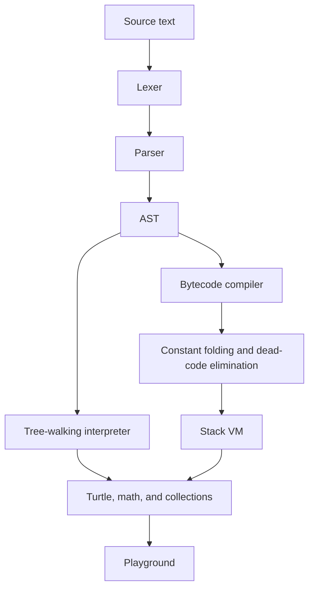

# Spool

Spool is a small programming language for games, running in the browser. The name is a film spool: a length of time you can wind back. This phase is the language core. A game loop, entities, coroutines, and rewind come later. The turtle is still here as ordinary commands, until it moves into a module.

The implementation is a hand-written **lexer**, **recursive descent parser**, **tree-walking interpreter**, and **stack VM** in TypeScript. No parsing libraries. Tests run the same programs on both backends.

## Language spec

Keep it small on purpose.

### Values and variables

- Numbers, strings, and booleans: `true`, `false`
- Arrays: `[1, 2, 3]`. Read with `a[i]`. Write with `a[i] = v`. Indexes are whole numbers starting at 0. A negative index is out of range.
- `len(array)` and `len(string)` return the length. `push(array, value)` adds an item and returns the same array.
- Define a name: `let size = 50`. A second `let` of the same name in one scope is an error.
- Change a name that already exists, including one outside the current block: `n = n + 1`
- Maps: `{ "ada": 10, bea: 12 }`. A bare key is the name, not a lookup. Read and write with `m["ada"]`. Missing keys are an error. `for k in m` visits keys in insertion order.
- Records: `record Paddle { x, y }` then `Paddle { x: 1px, y: 2px }`. Fields are `p.x` and `p.x = 1px`. Construction must supply every field.
- `vec(x, y)` is a pair. `+` and `-` are component-wise. `*` and `/` take a scalar. Both components share a unit. `v.x` and `v.y` read or write a component. `==` compares vecs by value.
- `==` and `!=` compare numbers, strings, booleans, quantities, and vecs by value. Arrays, maps, records, and functions are equal only when they are the same object.
- Comments start with `#`

### Expressions

- Arithmetic with correct precedence: `+` `-` `*` `/` `%`, parentheses, unary minus
- `+` adds two numbers, or joins two strings (`"Fizz" + "Buzz"`). A number plus a string is an error.
- A number can wear a unit: `1.5s`, `120px`, `80px/s`. `+` and `-` need the same unit. `*` and `/` combine units, and `px/s * s` is `px`. A plain number is its own kind, so `1px + 1` is an error. `10px / 2px` is the plain number `5`.
- Comparisons: `==` `!=` `<` `>` `<=` `>=`. Ordered comparisons need two numbers, or two quantities of the same unit.
- Booleans: `true` `false` `and` `or` `not`. `and` and `or` stop early. Conditions need a real boolean.
- Strings interpolate with braces: `"score: {score}"`. A literal brace is `\{`.
- The pipe `|>` calls a function with the value on the left. `1 + 2 |> inc` is `inc(3)`. `n |> add(10)` is `add(n, 10)`. It binds more loosely than `or`.
- `match` tries patterns in order: literals, quantities, `vec(x, y)`, `Point { x: x, y: _ }`, a name that binds, or `_`. The first match wins. If none match, the program stops.
- A function expression: `fn(x) { return x + 1 }`. It can be stored, passed, returned, and called. It closes over the names it can see.

### Control flow

- `if` / `else`. The `else` body is a block.
- `while`
- `repeat N { ... }`. `N` is a whole number, zero or greater.
- `for i in start..end { ... }`. `start` and `end` are whole numbers, read once. The range is exclusive, so `0..3` binds `i` to 0, then 1, then 2. Each pass gets its own `i`, so a function created in the body keeps that pass's value. Assigning to `i` does not move the counter.
- `for x in collection { ... }`. Arrays yield items, strings yield characters, and maps yield keys. The list is fixed when the loop starts. Each pass gets its own binding.

### Functions

- A named function is a statement: `fn square(s) { ... }`. It can call itself.
- An unnamed function is an expression: `fn(x) { return x }`. Its name in a stack trace is `(anonymous)`.
- Calls: `square(100)`, `fns[0]()`, `(fn(x) { return x })(1)`.
- `return` is only allowed inside a function.

### Math and collections

| Call | Meaning |
|------|---------|
| `sin(n)` `cos(n)` | Sine and cosine. `n` is radians, not degrees |
| `sqrt(n)` | Square root of a number that is zero or greater |
| `abs(n)` | Absolute value |
| `random()` | A number from 0 up to, but not including, 1 |
| `min(a, b, ...)` `max(a, b, ...)` | Smallest or largest of two or more numbers |
| `hsl(h, s, l)` | A color string. `h` is the hue in degrees, `s` and `l` are percentages |
| `len(value)` | Length of an array or a string |
| `push(array, value)` | Append `value` and return the array |

`random` is deterministic when a run is given a seed. The playground seed is the number in the toolbar, and it is part of the share link. The same program and the same seed do the same thing on the tree-walker and on the VM. With no seed, `random` uses `Math.random`.

### Turtle built-ins

| Command   | Meaning                          |
|-----------|----------------------------------|
| `forward` | Move forward by a distance       |
| `back`    | Move backward                    |
| `turn`    | Rotate clockwise by degrees. Heading 0 points up |
| `penup`   | Stop drawing                     |
| `pendown` | Start drawing                    |
| `color`   | Set pen color                    |
| `width`   | Set pen width                    |
| `goto`    | Jump to a position               |
| `print`   | Print a value (console / output) |

A turtle command can be written without parentheses when it is a statement: `forward 40`, `goto 10 20`. A parenthesis uses the normal call. A name you defined yourself always needs parentheses.

### Example

```
record Paddle { x, y }

fn nudge(p, dt) {
  return match p {
    Paddle { x: x, y: y } => Paddle { x: x + 40px/s * dt, y: y }
  }
}

let score = 0
let p = Paddle { x: 10px, y: 20px }
p = nudge(p, 1.5s)
"score: {score} at {p.x}"
```

`nudge` returns a new paddle 60px to the right. The string is `score: 0 at 70px`.

Turtle drawings still use the older commands:

```
fn square(s) {
  repeat 4 { forward s  turn 90 }
}
repeat 36 {
  square(100)
  turn 10
}
```

## Architecture



The playground runs the VM. The tree-walker is still the reference implementation, and the tests run every behavior on both.

| File | Role |
|------|------|
| `src/lexer.ts` | Text → tokens, with line and column |
| `src/ast.ts` | Node type definitions |
| `src/parser.ts` | Tokens → AST (recursive descent + precedence climbing) |
| `src/interpreter.ts` | Evaluate the AST. `debug` pauses between statements. No canvas knowledge |
| `src/bytecode.ts` | Instruction set, chunks, and the disassembler |
| `src/compile.ts` | AST → bytecode. Names are resolved when the instruction runs, so a closure sees the live scope |
| `src/optimize.ts` | Constant folding, then dead-code elimination. Each pass can be turned off |
| `src/vm.ts` | Stack machine. Same errors, same step counts, same turtle drawing as the tree-walker |
| `src/errors.ts` | Error codes, source line, caret, and "did you mean" |
| `src/math.ts` | Pure math and color built-ins |
| `src/collections.ts` | `len` and `push` |
| `src/rng.ts` | Seeded `random`, mulberry32 |
| `src/benchmark.ts` | The three programs the bench panel times |
| `src/turtle.ts` | Turtle state and drawing commands |
| `src/playground/` | Editor, canvas, inspector, debugger, timeline, and the bench worker |

Runtime guards: a step limit and a call-depth limit, so an infinite loop or a runaway recursion fails safely instead of freezing the page.

### Design decisions

**Two backends, one language.** The tree-walker is easy to read: each AST node is a function. The VM is there so the playground can show bytecode and so a tight recursive program can run faster. Tests call both and expect the same values, the same errors, and the same drawings. The optimizer is off in those tests. The playground turns both passes on, and a separate test checks that the gallery still draws with the passes on. Division by zero is not folded, so `1 / 0` still fails at the `/`.

**Closures share the scope object.** A function remembers the environment it was created in, not a copy of the values. That is why a named function can call itself: the name is written into that environment before the call. A `for` loop copies the counter into a fresh scope on every pass, so a function created in the body keeps that pass's `i`. Resolving names at run time costs a scope walk, and it means the compiler does not have to number slots. That trade is why a tiny loop does not get faster on the VM. A benchmark table is a later phase.

**The debugger pauses on statements, and time travel is a recording.** Both engines yield before each statement. The page stores up to 10,000 of those pauses, with the variables, the call stack, and how many turtle strokes existed. Dragging the timeline draws the strokes from the start up to that pause. It does not restart the machine at that point. Step forward along the recording until the live end, and only then does another statement run. If the cap is hit, the run continues and the timeline says later steps were not recorded.

**The seed lives in the link.** The hash is `#s=<seed>&<program>`. An older link that is only the program still loads, with seed 1.

## Where this is going

Not in the language yet: modules (`use draw`), a fixed-timestep game loop, entities and collision rules, tasks that `wait`, audio, and rewind. The playground can already show bytecode and scrub a recorded trace of a drawing. Those stay. A measured benchmark table and a demo GIF belong to a later phase.

## Playground

`npm run dev` opens the studio.

- **Run**, or Cmd/Ctrl-Enter, draws the program on the VM. The turtle walks each line. Drag **Speed** while it is drawing; the right end of the slider finishes the picture at once.
- **Step** pauses before the next statement. The first step highlights the line that is about to run, and the matching bytecode instruction. **Continue** runs until **Pause** or the end, without freezing the page. **Stop** leaves the debugger.
- **Back** and **Forward**, or Alt+Left and Alt+Right, move along the recorded trace. The canvas, the highlighted line, **Variables**, and **Call stack** follow the slider.
- While paused, **Variables** shows the scope chain and **Call stack** shows the functions that are running.
- The inspector beside the canvas has **Output**, **Tokens**, **AST**, **Bytecode**, and **Bench**. Tokens refresh as you type. Hover a tree node to mark its source; move the cursor and the matching node lights up. A parse error keeps the last good tokens and tree and shows a banner.
- **Bytecode** lists the program before and after the optimizer. **Constant folding** and **Dead-code elimination** can each be switched off. The counts above the listing are the instruction totals, including nested functions.
- **Print** and errors share the console under the editor. Every error has a code (`E0203`), the source line, a caret, and a suggestion when a name is one or two edits from a variable you defined.
- The status bar shows the cursor, token count, AST node count, run time, steps, and the deepest call.
- **Light** / **Dark** switches the theme. The paper under the turtle stays light in both, so the default pen stays visible. Drag the splitters to resize the editor and the inspector. Below 800px the canvas and the inspector sit above the editor.
- **Spiral**, **Snowflake**, **Tree**, **Flower**, **Koch**, **Sierpinski**, and **Rainbow** draw. **Primes**, **Sort**, **Fibonacci**, and **FizzBuzz** print, and they use arrays, `for`, string joining, or functions as values.
- **Seed** feeds `random`. The program and the seed are stored in the URL hash, so the address is a shareable link.

## What I'd do next

- `else if` without an extra block.
- Indexing a string, and a few more array operations (`pop`, a slice) without turning the language into a standard library.
- Resume a run from a timeline frame, instead of only replaying the drawing.
- Step one bytecode instruction, not only one statement.
- Give the compiler slots instead of looking names up in a linked scope, which is what the nested-loop number is asking for.
- A tree-walker path that does not pause, for people who want the readable engine to be the fast one too.
- Modules, so a drawing can `import` a `square` from another buffer.
- Deploy the static build, and record the demo GIF below.

## Demo

A short GIF of the studio belongs here once it is recorded:

A demo GIF of rewind belongs here once it is recorded. It is not in the repo yet.

## Build phases

Phases 1–13 are done. The language growth, the VM, the optimizer, the timeline, and the benchmarks are in the tree as well.

1. Project setup
2. Lexer
3. AST types
4. Parser: expressions
5. Parser: statements
6. Parser: functions and calls
7. Interpreter: expressions, variables, scopes
8. Interpreter: control flow
9. Interpreter: functions, return, recursion, limits
10. Friendly errors with line and column
11. Turtle module and canvas renderer
12. Playground: editor, Run, canvas, speed slider
13. Playground: example gallery, error underlines, shareable URL
14. Polish: demo GIF and deployment

Deployment and the demo GIF are still open.

## Getting started

```bash
npm install
npm test        # unit tests (Vitest). Both backends.
npm run dev     # playground at http://127.0.0.1:5173/
npm run build   # production static build
```

## Stack

- TypeScript + Vite (static site — GitHub Pages or Vercel still to come)
- Vitest for tests
- CodeMirror 6 for the editor, with a dark and a light theme
- Hand-written lexer, parser, tree-walker, compiler, and stack VM — no parsing libraries
